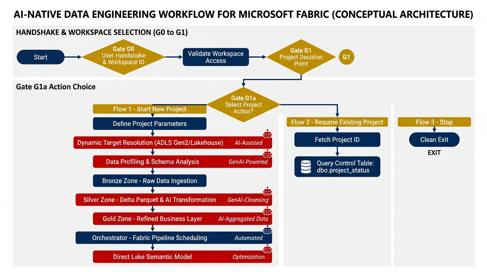

# End-to-End Architecture Flowchart Diagram

Below is the visual architecture flowchart diagram representing the complete workflow from conversation start, workspace selection, project action choice, and source lakehouse selection, through the **3 Action Flows** at Gate G1a (Start New Project, Resume Existing Project, and Stop).



---

## Interactive Mermaid Architecture Flowchart

```mermaid
flowchart TD
    Start(["User Initiates Conversation\n(START / Prompt)"]) --> G0["Gate G0: Check Azure CLI Connection"]

    G0 -->|CLI Connection Active| G0b["Gate G0b: Select Workspace\n[1/2/.../S]"]
    G0 -->|CLI Inactive| G0a["Gate G0a: Authenticate via az login?\n[y/n]"]

    G0a -->|y| AZLogin["Execute az login in embedded terminal"] --> G0b
    G0a -->|n| StopG0a["Print thank-you exit message & Stop"]

    G0b -->|Workspace Selected| G1a{"Gate G1a: Select Action\n[1/2/3]"}
    G0b -->|S (Stop)| StopG0b["Print thank-you exit message & Stop"]

    %% FLOW 1: START A NEW PROJECT
    G1a -->|1. Start New Project| G1["Gate G1: List & Select Source Lakehouse\n[y/n]"]
    G1 -->|y| F1_Scan["Scan Raw Source Folders in Source Lakehouse\n(e.g., /Files/Marine)"] --> G2
    G1 -->|n| StopG1["Print thank-you exit message & Stop"]

    G2["Gate G2: Dynamic Target Resolution\nSuggested: <Derived_Name> (Target Lakehouse: <Derived_Name>_LH)\n[y/n/<target_folder_name>]"]

    G2 -->|y / target_folder_name| G2Create["Create Target Folder <target_folder_name>\n(<target_folder_name>_LH, notebooks, orchestrator, semantic model)\n(Target Lakehouse creation deferred)"] --> G2b
    G2 -->|n| StopG2["Print thank-you exit message & Stop"]

    G2b["Gate G2b: Show File Details?\n[y/n]"] -->|y| G4["Gate G4: Run Data Profiling?\n[y/n]"]
    G2b -->|n| StopG2b["Print thank-you exit message & Stop"]

    G4 -->|y| Profiling["Execute Read-Only Livy Spark Profiling\n(Row counts, types, nulls, keys, dates)"] --> G5["Gate G5: Approve Profile?\n[APPROVE/DECLINE]"]
    G4 -->|n| StopG4["Print thank-you exit message & Stop"]

    G5 -->|APPROVE| Bronze["Stage 1: Bronze Layer (G6 - G7a)\nDeploy & Run Bronze_<Target>\n[y/n/skip] Prompt\nWrite bronze.<stem> & Log to dbo.project_status"]
    G5 -->|DECLINE| ProfileFix["Interactive Issues Loop"] --> G4

    Bronze --> G8_Up["Stage 2: Silver Layer (G8 - G10a)\nUpload/Skip Business Rules"]
    G8_Up --> G8_Sum["Output Business Rules Understanding Summary\n(Rule IDs, target columns, 5-level precedence)"]
    G8_Sum --> Silver["Deploy & Run Silver_<Target>\n[y/n/skip] Prompt\nWrite silver.<stem> & Log to dbo.project_status"]

    Silver --> G11_Up["Stage 3: Gold Layer (G11 - G12c)\nUpload/Skip Client STTM Document"]
    G11_Up --> G11_Sum["Output STTM Understanding Summary\n(Dimensions, Facts, SHA-256 keys, Measures)"]
    G11_Sum --> Gold["Deploy & Run Gold_<Target>\n[y/n/skip] Prompt\nWrite gold.<entity> & Log to dbo.project_status"]

    Gold --> Orch["Stage 4: Orchestrator Pipeline (G13 - G13c)\nDeploy & Run <Target>_Medallion_Orchestrator\n[y/n/skip] Prompt\nLog to dbo.project_status"]

    Orch --> Sem["Stage 5: Direct Lake Semantic Model (G14 - G14c)\nDeploy & Refresh <Target>_Gold_Model\n[y/n/skip] Prompt\nLog to dbo.project_status"]

    Sem --> G15{"Gate G15: Process Another Dataset?\n[y/n]"}
    G15 -->|y| G2
    G15 -->|n| ExitClose["Session Closed cleanly. Thank you!"]

    %% FLOW 2: RESUME AN EXISTING PROJECT
    G1a -->|2. Resume Existing Project| F2_Disc["2-Tier Project Discovery\n(Check Root Lakehouses & Workspace Folders for dbo.project_status)"] --> F2_Query["Query dbo.project_status in Selected Project\nGet current_project_stage, current_gate & completion_percentage"]
    F2_Query --> F2_Eval["Display Project Stage Summary\n(Stage, Status, Gate, Next Action, Completion %)"]
    F2_Eval --> F2_CheckPending{"Prompt directly at current_gate\n(G-pending)"}

    F2_CheckPending -->|Pending: Silver| G8_Up
    F2_CheckPending -->|Pending: Gold| G11_Up
    F2_CheckPending -->|Pending: Orchestrator| Orch
    F2_CheckPending -->|Pending: Semantic Model| Sem
    F2_CheckPending -->|All Completed| G15

    %% FLOW 3: STOP
    G1a -->|3. Stop| StopAction["Print thank-you exit message\nSession stopped cleanly"]

    %% Styling
    classDef startEnd fill:#003366,stroke:#333,stroke-width:2px,color:#fff;
    classDef gate fill:#E6F0FA,stroke:#003366,stroke-width:2px,color:#003366;
    classDef action fill:#FFF9E6,stroke:#D99B00,stroke-width:1.5px,color:#333;
    classDef stop fill:#FADBD8,stroke:#C0392B,stroke-width:1.5px,color:#78281F;

    class Start,G15,ExitClose startEnd;
    class G0,G0a,G0b,G1,G1a,G2,G2b,G4,G5,G15,F2_CheckPending gate;
    class F1_Scan,G2Create,Profiling,Bronze,Silver,Gold,Orch,Sem,F2_Disc,F2_Query,F2_Eval,G8_Sum,G11_Sum action;
    class StopG0a,StopG0b,StopG1,StopG2,StopG2b,StopG4,StopAction stop;
```

---

## Detailed Summary of Paths

### 1. Handshake & Setup (G0 – G1a)
- Verifies Azure CLI connection (`az login` if inactive).
- User selects active workspace from tenant list (`G0b`).
- **Immediately after workspace selection, Gate G1a asks user to choose Action** (`[1/2/3]`: 1 Start new project, 2 Resume existing project, 3 Stop).

### 2. Action Choice Flows (G1a)
- **Flow 1: Start a New Project**
  1. Prompts Gate G1 to list and select the Source Lakehouse (`{raw_lakehouse}`).
  2. Scans raw source subdirectories (e.g., `Files/Marine/`).
  3. Resolves target folder name dynamically at Gate G2 (`<Derived_Name>` or custom write-in) and creates target folder `<target_folder_name>` containing directly `<target_folder_name>_LH`, `notebooks`, `orchestrator`, `semantic model`. Target Lakehouse `<Target>_LH` creation is deferred until notebook/orchestrator execution.
  4. Displays file details (G2b) and performs Livy Spark read-only data profiling (G4/G5).
  5. Sequentially executes **Stage 1 (Bronze)** $\rightarrow$ **Stage 2 (Silver)** $\rightarrow$ **Stage 3 (Gold)** $\rightarrow$ **Stage 4 (Orchestrator)** $\rightarrow$ **Stage 5 (Semantic Model)**.
  6. All layer run prompts offer **`[y/n/skip]`** (where `skip` moves directly to the next stage).
  7. After G8 Business Rules upload, outputs a structured **Business Rules Understanding Summary**.
  8. After G11 STTM upload, outputs a structured **STTM Understanding Summary**.
  9. Logs stage completion rows to `dbo.project_status` in `<Target>_LH`.
  10. Reaches Gate G15 to process another dataset target or exit.

- **Flow 2: Resume an Existing Project**
  1. Performs 2-tier project discovery: (a) checks standalone root workspace lakehouses for `dbo.project_status`, (b) checks workspace folders (`<target_folder_name>`) for a lakehouse containing `dbo.project_status`.
  2. Displays discovered projects and prompts user selection.
  3. Queries `dbo.project_status` in schema `dbo` ordering by `updated_at DESC`.
  4. Displays completed stages (`COMPLETED`, `SKIPPED`).
  5. Resumes execution seamlessly at the exact pending gate (`G-pending`).

- **Flow 3: Stop**
  1. User selects `3` at Gate G1a.
  2. AI prints a courteous thank-you exit message: *"Thank you! Session stopped cleanly."*
  3. Exits protocol without creating artifacts or running commands.
